<div align="center">

<picture>
  <source media="(prefers-color-scheme: dark)" srcset="assets/banner-dark.svg">
  <source media="(prefers-color-scheme: light)" srcset="assets/banner-light.svg">
  
</picture>

<a href="https://git.io/typing-svg"></a>

</div>


## 🛰️ &nbsp;Mission Control

> **Backend engineer who builds systems that think — and remember.**

Backend engineer with 4+ years of production systems behind every AI agent I ship. I've built the backend of a fantasy sports platform serving **200,000+ users**, an end-to-end **Finix payment** flow (3DS2, ACH, webhooks, idempotent processing) and a multi-tenant CRM handling **50,000+ leads**. I design **multi-agent systems with graph memory**, RAG pipelines and structured LLM outputs, and run them to the same standard as any backend: FastAPI services, concurrency-safe writes, automated tests and full tracing.

```python
class KuldeepSingh:
    role       = "Backend Engineer – GenAI & Agentic AI"
    location   = "Jaipur, India"
    experience = "4+ years"

    languages  = ["Python", "JavaScript", "SQL", "Cypher", "PHP"]
    ai_stack   = ["LangGraph", "LangChain", "LangSmith", "RAG", "Multi-Agent Systems", "Groq"]
    backend    = ["FastAPI", "Node.js", "Express.js", "REST APIs", "Webhooks", "Event-Driven"]
    databases  = ["PostgreSQL", "MySQL", "MongoDB", "Redis", "ChromaDB", "FalkorDB"]
    cloud      = ["AWS (EC2, S3, RDS, Lambda, SQS)", "Docker", "GitHub Actions"]

    current_focus = "Agents with long-term memory: semantic, episodic, procedural"
    status        = "Open to Backend / GenAI / Agentic AI roles"
```


## 🚀 &nbsp;Missions

<a href="https://github.com/Kuldeep-Singh-Naruka/recallops">
<picture>
  <source media="(prefers-color-scheme: dark)" srcset="assets/mission-recallops-dark.svg">
  <source media="(prefers-color-scheme: light)" srcset="assets/mission-recallops-light.svg">
  
</picture>
</a>

<details>
<summary><b>🛰️ RecallOps — deep dive</b></summary>
<br/>

| | |
|---|---|
| **What** | Incident-response agents that remember every incident, every step and which fixes actually worked. Built for the **Graph Hacks** hackathon by WeMakeDevs × FalkorDB (Oct 2026) |
| **How** | LangGraph pipeline: `triage → (dependency_scout ∥ memory_scout) → investigator → resolver`, sharing one FalkorDB graph |
| **Memory** | **Semantic** (service map), **episodic** (incident → steps → agent), **procedural** (fixes with success/fail scores), plus persistent chat |
| **Learning** | Recalls fixes up to 3 dependency hops away with Cypher, ranks them by track record, and updates scores from human "fix worked / didn't work" |
| **Concurrency** | Atomic, exactly-once Cypher writes: 50 threads → **0 lost updates** (naive read-modify-write lost 48 of 50) · 35 automated tests |
| **Safety** | Per-tenant graphs; rules enforced in code: never repeat a failed fix, escalate after 3 failures |
| **Stack** | Python, LangGraph, FalkorDB, Cypher, Groq (gpt-oss-120b), Streamlit, Docker |

</details>

<a href="https://github.com/Kuldeep-Singh-Naruka/API-Integration-Monitor-Agent">
<picture>
  <source media="(prefers-color-scheme: dark)" srcset="assets/mission-api-monitor-dark.svg">
  <source media="(prefers-color-scheme: light)" srcset="assets/mission-api-monitor-light.svg">
  
</picture>
</a>

<details>
<summary><b>📡 API Integration Monitor Agent — deep dive</b></summary>
<br/>

| | |
|---|---|
| **What** | Autonomous AI agent that monitors third-party API documentation for breaking changes |
| **How** | 5-node LangGraph state machine: `fetch → compare → summarize → classify → suggest fix` |
| **Intelligence** | LLM classifies each change as **breaking** or **non-breaking** and generates suggested code fixes |
| **RAG** | Vector search with embeddings in ChromaDB to retrieve relevant documentation context |
| **Observability** | End-to-end tracing of every agent step with LangSmith |
| **Stack** | Python, FastAPI, LangGraph, LangChain, PostgreSQL, ChromaDB, LangSmith |

</details>

<a href="https://github.com/Kuldeep-Singh-Naruka/HireFlow">
<picture>
  <source media="(prefers-color-scheme: dark)" srcset="assets/mission-hireflow-dark.svg">
  <source media="(prefers-color-scheme: light)" srcset="assets/mission-hireflow-light.svg">
  
</picture>
</a>

<details>
<summary><b>🔭 HireFlow — deep dive</b></summary>
<br/>

| | |
|---|---|
| **What** | AI-powered candidate screening & interview intelligence platform |
| **How** | LLM pipeline (Groq + LangChain) extracts structured job requirements & candidate profiles |
| **Unique** | Cited, explainable matches with **quoted source evidence**, not opaque scores |
| **Smart** | Auto-generates targeted interview questions from identified skill gaps |
| **Stack** | Python, FastAPI, PostgreSQL, Groq, LangChain, React |

</details>


## 🛠️ &nbsp;Flight Systems

<div align="center">

### 🤖 Generative AI & Agentic AI


### ⚡ Languages & Backend


### 🗄️ Databases


<br/>

-FF4438?style=for-the-badge&logoColor=white)

-5C2D91?style=for-the-badge&logoColor=white)

### ☁️ DevOps & Cloud


</div>


## 💼 &nbsp;Flight Log

<div align="center">

### 4+ years in production

| | Impact |
|:---:|:---|
| 👥 | **200,000+** users served on a fantasy sports platform |
| 💳 | Built an **end-to-end payment system** (Finix, Evervault, 3DS2, ACH) |
| 🛡️ | Reduced fraud false positives by **30%** (Ethoca) |
| 🔁 | **Idempotent** recovery for failed ACH transfers, with no duplicate transactions |
| 📊 | Optimized APIs for **50,000+ leads** in a multi-tenant CRM |
| 📈 | Increased lead conversion by **25%** |
| ⏱️ | Saved **20+ hours/month** through automation |
| 🔄 | Reduced manual data entry by **80%** (DeskTrack HR) |
| ⚡ | Cut page load time by **40%** |

</div>


## 🧠 &nbsp;What Sets Me Apart

<table align="center">
<tr>
<td width="50%" valign="top">

### 🤖 AI Engineering
- **Multi-agent systems** with LangGraph (parallel agents, handoffs)
- **Agent memory** in a graph: semantic, episodic, procedural
- **RAG pipelines** with vector search (ChromaDB)
- Structured LLM outputs & grounded citations
- Full observability with **LangSmith** tracing

</td>
<td width="50%" valign="top">

### ⚙️ Backend Engineering
- **Event-driven** architectures with webhooks
- **Idempotent**, concurrency-safe writes
- Multi-tenant systems with data isolation
- Payment integrations (Finix, 3DS2, ACH)
- System design & API performance optimization

</td>
</tr>
</table>

<br/>

<picture>
  <source media="(prefers-color-scheme: dark)" srcset="assets/footer-dark.svg">
  <source media="(prefers-color-scheme: light)" srcset="assets/footer-light.svg">
  
</picture>

<div align="center">

<sub>Banner, mission cards and dividers are hand-made SVGs: <code>python assets/generate.py</code></sub>

</div>
